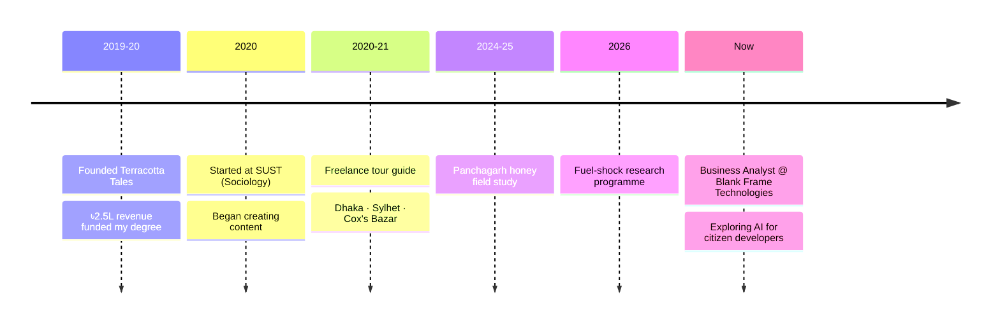

<!-- Header -->
<p align="center">
  
</p>

<p align="center">
  <a href="https://github.com/shifa-desu">
    
  </a>
</p>

<p align="center">
  <a href="http://farzana.sch.ac/"></a>
  <a href="https://www.blankframe.tech/shifa/"></a>
  <a href="mailto:farzanarezashifa@gmail.com"></a>
</p>

---

## 🌿 About me

I'm a **sociologist by training** (BSS Sociology, SUST) and currently a **Business Analyst at [Blank Frame Technologies](https://www.blankframe.tech/shifa/)**.
My work sits where people, data, and decisions meet: I turn scattered field data into reports someone can act on, and stakeholder conversations into requirements a team can build.

I'm genuinely excited about **AI as a tool for citizen developers**: the idea that ordinary people, not just engineers, can now build useful things that make their own lives better. I use **Claude** every day as a research partner for literature scans, structuring field data, drafting study designs, and stress-testing my own arguments.

```yaml
shifa:
  trained_as:   Sociologist  # SUST, Sylhet
  works_as:     Business Analyst @ Blank Frame Technologies
  also:         [Field Researcher, Digital Creator, Small-business Founder]
  based_in:     Sylhet / Dhaka, Bangladesh 🇧🇩
  obsessed_with: "AI that lets non-coders build real things"
  research_copilot: Claude
  fun_fact:     "Funded my own university studies by running my own business"
```

---

## ✨ What I do

<table>
  <tr>
    <td width="50%" valign="top">

### 📊 Business Analysis
- Stakeholder interviews & needs assessment
- Turning messy requirements into clear specs
- Dashboards & reporting that people actually read
- Fluent Bangla ⇄ English documentation

  </td>
  <td width="50%" valign="top">

### 🔍 Applied Field Research
- Informal micro-economies & seasonal shocks
- Economic ethnography & case studies
- How households absorb economic policy in real time
- AI-assisted research workflows with Claude

  </td>
  </tr>
  <tr>
    <td width="50%" valign="top">

### 🏺 Entrepreneurship
- Founded & ran small businesses end to end
- Investor pitching & fundraising
- Vendor negotiation & supply chains
- Cash-flow & budget management

  </td>
  <td width="50%" valign="top">

### 🎬 Digital Content
- Bike vlogs, productivity hacks & AI experiments
- **0.5M+** views on top post · **65K+** avg across top 10
- Audio recording & mixing for indie singers
- High-retention storytelling

  </td>
  </tr>
</table>

---

## 🔬 Featured work

| | Project | What it is |
|---|---|---|
| 🍯 | **[Lichur Modhu: Migratory Beekeepers of Panchagarh](http://farzana.sch.ac/research/panchagarh-honey/)** | Economic ethnography of litchi-honey apiarists: the 20-day bloom cycle, pollination barter with orchard owners, and the middleman squeeze (৳300/kg farmgate vs ৳1,200/kg retail). |
| ⛽ | **[r1_Fuel: Bangladesh's 2026 Fuel Shock](http://farzana.sch.ac/fuel_shock_bd/)** | The social life of a fuel-price hike: impact analysis, five costed study designs, an open discourse-analysis corpus, and a live audit log. |
| 🏺 | **[Terracotta Tales](http://farzana.sch.ac/terracotta-tales/)** | My artisanal terracotta pottery venture. It made **৳2.5 lakh in one year** and paid my SUST tuition and living costs. Pitched angel investors, worked with master potters across three cities, and engineered zero-breakage straw packaging. |

---

## 🧭 Journey



---

## 🛠️ Toolkit

<p>
  
  
  
  
  
  
  
  
  
</p>

> 📓 *Tracking life on Notion since 2021.*

---

## 🏍️ Off the clock

`Moto vlogging` · `Cycling` · `Hiking` · `Crochet & DIY` · `Proud cat mom 🐈` · `Playing with UI/UX & AI tools`

---

<p align="center">
  <i>"The most interesting number is never the headline one. It's the one nobody measured because it happened inside a household, not a spreadsheet."</i>
</p>

<p align="center">
  
</p>


